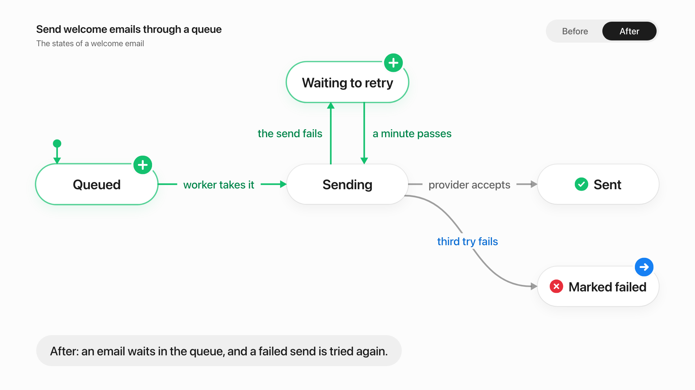

# system-diff

Turn a pull request into a short video of what it changes in the system.

[](demo/system-diff-demo.mp4)

A line diff shows what was typed. A system diff shows what the system now does differently: which components and flows were added or removed, which states a thing can now move through, which facts flipped, and what new way it can fail.

`system-diff` is an agent skill. Your coding agent reads the change, works out the system diff, and renders it as a short video you can attach to the pull request.

## What a video contains

1. **Title**: what the change does.
2. **Before and after**, in the diagram that fits the change, or in both:
   - a **component view** when the wiring changes: the components and the flows between them, rewired;
   - a **statechart** when a lifecycle changes: the states one thing moves through, such as an order or a job, and the events that move it.
3. **Facts**: up to four values flipping from old to new, such as a timeout or who may do what.
4. **New failure mode**: the component that stops and what the others do then, or the path into a state that goes wrong.
5. **Close**: the one thing to remember, with a count of what changed.

The agent picks the diagram. A video with one runs about 30 seconds, and one with both about 50.

Three rules keep it honest:

- Every changed component, flow, state, transition and fact in the video cites the file and line that shows it.
- A change that leaves the system as it was, such as a refactor, gets a plain "no system diff" and no video.
- The agent reads a contact sheet of the finished frames and fixes what it sees before handing the video over.

## Install

As a Claude Code plugin:

```
/plugin marketplace add technotopicus/system-diff
/plugin install system-diff@technotopicus
```

For other agents, with [skills.sh](https://skills.sh):

```
npx skills@latest add technotopicus/system-diff
```

Install both skills, `system-diff` and `setup-system-diff`.

## Set up first

Run the setup skill once per machine:

```
/setup-system-diff
```

You need nothing installed beforehand. Setup checks the machine, tells you what it will download, asks whether you want narration, and ends by building a test clip so you know it works.

| It needs | If you don't have it |
|---|---|
| Node 20 or newer | setup offers to install it |
| A browser to draw the frames | uses your Chrome, or downloads Chromium (about 200 MB) |
| ffmpeg | uses yours, or downloads one (about 80 MB) |
| A voice, optional | Kokoro, a free voice that runs on your machine (about 500 MB), or any text-to-speech command you already use |

Everything goes into `~/.system-diff`. Deleting that folder undoes the setup. Run setup again to change the voice.

Narration is optional: with no voice, the video carries the same story in captions.

## Use

Ask your agent, in a repository:

```
Make a system diff of this branch.
Make a system diff of pull request 482.
```

It hands back the video, the claims it made and the evidence for each.

## How it works

```
pull request or branch
   │  the agent reads the diff and the code around it
   ▼
system-diff.json      components, flows, states, facts, failure mode, captions
   │  scripts/system-diff.mjs: HTML frames → optional speech → ffmpeg
   ▼
system-diff.mp4 and a contact sheet
```

The spec is plain JSON, so you can edit it and rebuild by hand. [`SPEC.md`](skills/system-diff/SPEC.md) describes every field, and [`welcome-email-queue.json`](skills/system-diff/examples/welcome-email-queue.json) is the spec behind the video above. [`order-cancellation.json`](skills/system-diff/examples/order-cancellation.json) is a statechart on its own.

```
node skills/system-diff/scripts/system-diff.mjs doctor
node skills/system-diff/scripts/system-diff.mjs build skills/system-diff/examples/welcome-email-queue.json --out ./out
```

## Status

Built and tested on macOS. Linux and Windows should work and are untested; issues are welcome.

## Licence

MIT. Setup downloads third-party tools under their own licences, including ffmpeg (GPL) and the Kokoro voice model (Apache 2.0).
